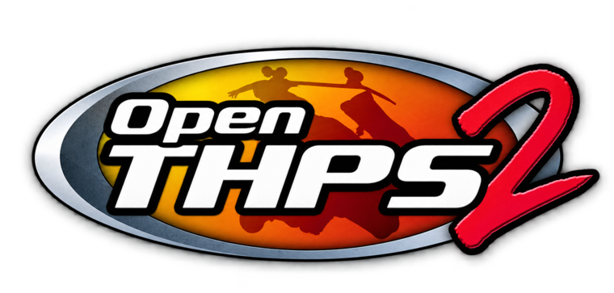

<p align="center">
  
</p>

<h1 align="center">OpenTHPS2</h1>

<p align="center">
  <a href="https://www.rust-lang.org/"></a>
  <a href="https://bevyengine.org/"></a>
  <a href="LICENSE"></a>
  <a href="#status"></a>
  <a href="PROGRESS.md"></a>
</p>

<p align="center">
  <a href="PROGRESS.md"></a>
</p>

<p align="center">
  <b>Tony Hawk's Pro Skater 2, rebuilt in Rust on your own copy of the game.</b><br>
  The same levels, skaters, physics, tricks and scoring, running natively on modern Windows and Linux,<br>
  with bugs fixed, an improved default renderer, and room for mods.
</p>

> [!IMPORTANT]
> OpenTHPS2 is an independent project, not affiliated with or endorsed by Activision or Neversoft. It contains no game
> files. You need your own copy of the game.

## Status

OpenTHPS2 is early. Today you can skate **The Hangar as Tony Hawk** in a two-minute session: ollies, flips, grabs,
grinds, lips, wallrides, manuals, specials, combos and bails, with scoring, the clock, the end screens and Retry. It is
checked frame by frame against recorded runs of the original game.

Career mode is on its way. Goals, cash, pickups and the career save format already work like the original's under the
hood, but there is no career menu yet. Menus, audio, the other levels and multiplayer are still to come, and some moves
can still end a session with a message about an unsupported situation.

<!-- progress --> 22.8% of the executable implemented by bytes (388 of 4720 functions), 8.1% more recovered. <!-- /progress -->
Every reimplemented routine is listed in [PROGRESS.md](PROGRESS.md).

## Highlights

- **The real THPS2** - original physics, trick timing, scoring and career, read from your own game data.
- **Native on Windows and Linux** - a modern 64-bit build of the game.
- **Modern displays** - high resolutions, widescreen and high refresh rates, with the original 30 Hz simulation kept intact.
- **Improved Draw Distance and Memory** - The default improved renderer running on your GPU offer improvements like no limits on draw distance or memory allowing for larger skate parks, intricate modifications, and much more!
- **Bugs fixed** - clear mistakes of the original are corrected and listed in [BUGFIXES.md](BUGFIXES.md).
- **Your saves keep working** - career saves and created parks made for the Classic Renderer stay compatible with the original and OpenTHPS2.
- **Made for modding** - custom skaters, levels and trick scripts are part of the plan from the start.

Faithful comes first: anything that changes how the game plays, such as cheats or mods, will always be
something you switch on yourself. Everything that is planned is in the [roadmap](ROADMAP.md).

### Controls

| Key | Action |
| --- | --- |
| Arrow keys | Move and steer |
| Z | Ollie (hold to crouch, release to jump) |
| X | Flip tricks |
| C | Grab tricks |
| V | Grind |
| A / S | Spin left / right |
| Enter | Ollie, and choose on the end screens |

These keys are temporary; remappable keyboard and controller input will follow. The window is 640×480 for now.


## Manual Build

A binary release and an installer that allows you to graphically pick your THPS2 install and update OpenTHPS2 is planned for both Windows and Linux. 

This has not been implemented yet, however, so for now you need to manually build towards your own **Tony Hawk's Pro Skater 2 for Windows (USA rerelease)**. OpenTHPS2 reads `ALL.PKR` from the game's
`SETUP/data` folder and checks it against the known release (SHA-256
`7e2ae173577c41598dc644824b52f7eaf9664ea478e177a8703f77c0185207da`). There are no release builds yet, so for now you
build OpenTHPS2 from source with [Rust](https://rust-lang.org/tools/install/).

### Windows

Windows builds are made with Ubuntu on WSL. Install it from an administrator PowerShell
([Microsoft's guide](https://learn.microsoft.com/en-us/windows/wsl/install)) and restart when asked:

```powershell
wsl --install -d Ubuntu
```

Open Ubuntu, install [Rust](https://rust-lang.org/tools/install/) there, then build the Windows executable:

```bash
sudo apt update
sudo apt install build-essential git curl pkg-config gcc-mingw-w64-x86-64 g++-mingw-w64-x86-64
rustup target add x86_64-pc-windows-gnu
git clone https://github.com/larsoyd/openthps2.git
cd openthps2
CARGO_TARGET_X86_64_PC_WINDOWS_GNU_LINKER=x86_64-w64-mingw32-gcc \
  cargo build --locked --release -p thps2-rs --features viewer --target x86_64-pc-windows-gnu
```

Copy `target/x86_64-pc-windows-gnu/release/thps2-rs.exe` to a Windows folder and start it from PowerShell:

```powershell
.\thps2-rs.exe --data-root "C:\Games\THPS2\SETUP\data" --play
```

The Windows build is compiled by continuous integration but has not been tried on many machines yet. Reports are
welcome.

---

### Linux

Install the build tools and graphics libraries for your distribution, plus the Vulkan driver for your GPU:

| Distribution | Command |
| --- | --- |
| Ubuntu 24.04 or newer | `sudo apt install build-essential git curl pkg-config libx11-dev libxcursor-dev libxrandr-dev libxi-dev libxkbcommon-x11-0 libvulkan1 mesa-vulkan-drivers` |
| Fedora | `sudo dnf install gcc-c++ git curl pkgconf-pkg-config libX11-devel libXcursor-devel libXrandr-devel libXi-devel libxkbcommon-x11 vulkan-loader mesa-vulkan-drivers` |
| Arch Linux | `sudo pacman -S --needed base-devel git curl libx11 libxcursor libxrandr libxi libxkbcommon-x11 vulkan-icd-loader`, plus `vulkan-radeon` or `vulkan-intel` |

NVIDIA users need their distribution's NVIDIA driver instead of the Mesa packages. Then build and play:

```bash
git clone https://github.com/larsoyd/openthps2.git
cd openthps2
cargo build --locked --release -p thps2-rs --features viewer
./target/release/thps2-rs --data-root "/path/to/SETUP/data" --play
```

On Wayland desktops the game currently runs through XWayland.


## Contributing

Contributions are welcome. Keep your game files outside the source tree and point the application at them with
`--data-root`. Never add files from the game to the repository. [DEVELOPMENT.md](DEVELOPMENT.md) covers the source
layout, diagnostic commands and how the reimplementation is checked against the original.

## License

MIT, see [LICENSE](LICENSE). The game, its data and its name belong to their rights holders; nothing from the game is
distributed here.
